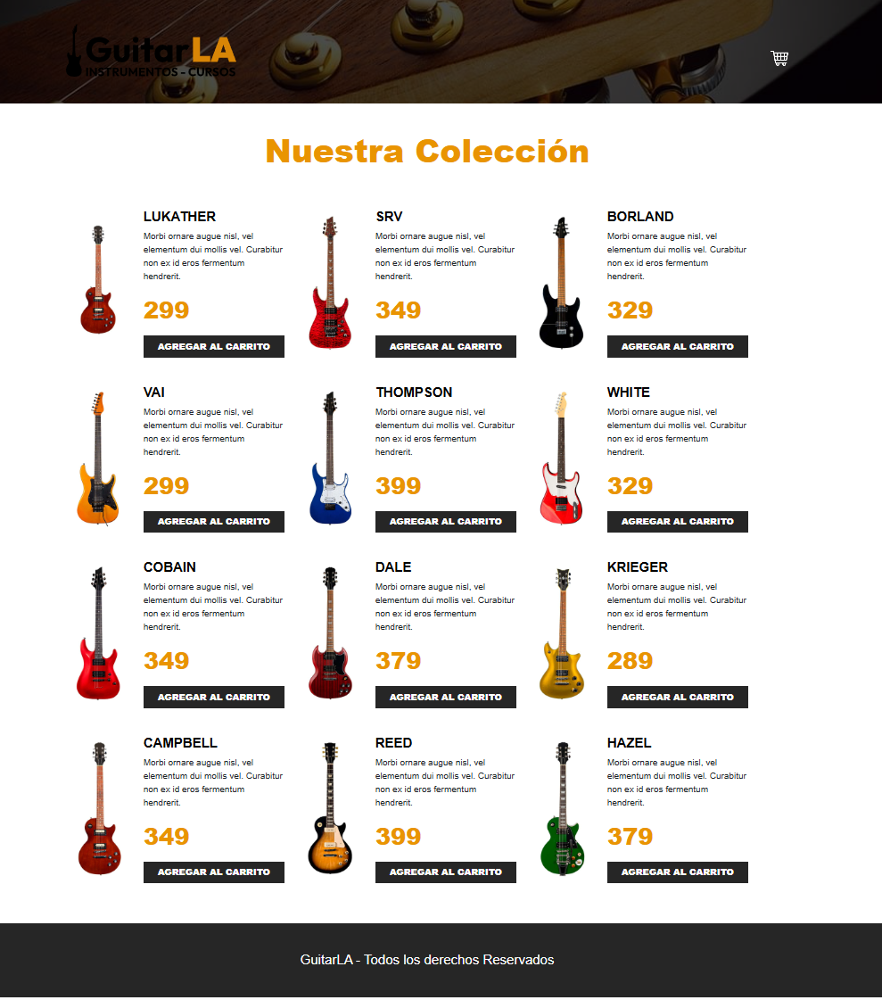

# GuitarLA – React + TypeScript

Tienda de guitarras con carrito de compras hecha con React 19, TypeScript y Vite. Este documento presenta el sistema y explica tanto la arquitectura técnica como las decisiones de desarrollo del frontend.

    Índice

1. [Visión General del Proyecto](-visión-general-del-proyecto)
2. [Ficha Técnica y Tecnologías](-ficha-técnica-y-tecnologías)
3. [Arquitectura e Implementación en React](-arquitectura-e-implementación-en-react)
4. [Patrones, Estado y Persistencia](-patrones-estado-y-persistencia)
5. [Puesta en Marcha](-puesta-en-marcha)

   Visión General del Proyecto

   Nombre y propósito

GuitarLA (TypeScript Edition) es el frontend de una tienda de instrumentos musicales. Resuelve los problemas clásicos de un carrito de compras:

- No perder el carrito: el estado se sincroniza con localStorage , así que sobrevive a recargas o cierres accidentales.
- Límites por producto: mínimo 1 y máximo 5 unidades por guitarra.
- Totales automáticos: el importe total y el estado "carrito vacío" se calculan solos cuando el carrito cambia.
- Carrito flotante: desde el encabezado se puede agregar, sumar, restar, eliminar un producto o vaciar todo con un clic.

> Las imágenes de la aplicación se encuentran en `/public/img/` (`header.jpg`, `carrito.png`, catálogo de guitarras). Las imágenes utilizadas en este README se encuentran en [`./Imagenes_Proyecto/`](./Imagenes_Proyecto/) (`logo.svg` y `Principal.png`).

    Despliegue

- Repositorio: [Ricardo-Patlan/GuitarsLA-ts](https://github.com/Ricardo-Patlan/GuitarsLA-ts)
- Demo en producción: _(pendiente; se puede publicar en Vercel, Netlify o GitHub Pages)_

  Ficha Técnica y Tecnologías

  Lenguajes

| Lenguaje   | Versión       | Nivel de tipado                                                                                                                                                           |
| :--------- | :------------ | :------------------------------------------------------------------------------------------------------------------------------------------------------------------------ |
| TypeScript | ~6.0.2        | Alto. Modo estricto ( "strict": true , "noUnusedLocals": true , "noUnusedParameters": true ). Entidades ( Guitar , CartItem ) y props ( GuitarProps , CartProp ) tipadas. |
| JavaScript | ES2022+ (ESM) | Módulos nativos, desestructuración y funciones flecha.                                                                                                                    |

    Librerías UI y estilos

- React y React DOM ^19.2.8 .
- Bootstrap 5.2.3 : grillas responsivas ( container-xl , row , col-md-6 , col-lg-4 ) y tablas. Está integrado en src/index.css .
- CSS propio: carrito desplegable (posición flotante con z-index , efectos :hover y botones circulares).

  Entorno y tooling

- Bundler: Vite ^8.3.0 con @vitejs/plugin-react ^6.1.1 .
- Gestor de paquetes: npm (compatible con yarn y pnpm).
- Calidad de código: ESLint ^10.10.0 , typescript-eslint ^8.69.0 , eslint-plugin-react-hooks ^7.1.1 y eslint-plugin-react-refresh ^0.5.6 .

  Dependencias clave

| Dependencia      | Tipo       | Versión  | Propósito                    |
| :--------------- | :--------- | :------- | :--------------------------- |
| react            | Producción | ^19.2.8  | Construir la interfaz        |
| react-dom        | Producción | ^19.2.8  | Renderizar en el DOM         |
| vite             | Desarrollo | ^8.3.0   | Compilación y servidor local |
| typescript       | Desarrollo | ~6.0.2   | Verificación de tipos        |
| @types/react     | Desarrollo | ^19.2.18 | Tipos de React               |
| @types/react-dom | Desarrollo | ^19.2.7  | Tipos de React DOM           |
| eslint           | Desarrollo | ^10.10.0 | Análisis estático del código |

> El proyecto no usa librerías de iconos, enrutamiento ni clientes HTTP.

    Arquitectura e Implementación en React

mermaid
graph TD
subgraph Datos
DB[(db.ts - Catálogo)]
LS[(localStorage - 'cart')]
end

    subgraph Custom Hook
        useCart["useCart.ts - Estado: cart, data - Funciones: add, remove, inc, dec, clear - Calculados: isEmpty, cartTotal"]
    end

    subgraph Componentes
        App["App.tsx (inteligente)"]
        Header["Header.tsx (presentacional)"]
        Guitar["Guitar.tsx (presentacional x12)"]
    end

    DB -->|lectura inicial| useCart
    LS <-->|sincronización| useCart
    useCart -->|estado y acciones| App
    App -->|cart, funciones, totales| Header
    App -->|guitar, addToCart| Guitar

    Hooks nativos

      useState : estados locales

typescript
const [data] = useState(db); // catálogo fijo de guitarras
const [cart, setCart] = useState(initialCart); // carrito de compras

Al carrito se le pasa la función initialCart (inicialización perezosa) y no su resultado. React la ejecuta solo en el primer render, así localStorage se lee una sola vez.

typescript
const initialCart = (): CartItem[] => {
const localStorageCart = localStorage.getItem('cart');
try {
const parsed = localStorageCart ? JSON.parse(localStorageCart) : [];
return Array.isArray(parsed) ? parsed : [];
} catch (error) {
console.error("Error al leer el carrito de localStorage:", error);
localStorage.removeItem('cart');
return [];
}
};

      useEffect : efectos secundarios

typescript
useEffect(() => {
localStorage.setItem('cart', JSON.stringify(cart));
}, [cart]);

Cada vez que cart cambia, se guarda en localStorage . Esto separa el guardado de la lógica de las funciones del carrito.

      useMemo : optimización de cálculos

typescript
const isEmpty = useMemo(() => cart.length === 0, [cart]);
const cartTotal = useMemo(
() => cart.reduce((total, item) => total + item.quantity \* item.price, 0),
[cart]
);

Ambos valores solo se recalculan cuando cart cambia.

      useRef ,  useCallback ,  useContext ,  useReducer : no implementados

| Hook        | Motivo                                                                                 |
| :---------- | :------------------------------------------------------------------------------------- |
| useCallback | Las funciones son ligeras y los componentes no usan React.memo ; no hay beneficio.     |
| useRef      | No fue necesario. Podría servir luego para cerrar el carrito al hacer clic fuera.      |
| useContext  | Solo hay 1 nivel de props ( App → Header y App → Guitar ); un Context sería excesivo.  |
| useReducer  | Será el siguiente paso si crecen las acciones del carrito o las validaciones de stock. |

    Custom Hooks

      useCart  ( src/hooks/useCart.ts )

Encapsula toda la lógica del carrito, separada de la parte visual. Se usa en App.tsx , que reparte los valores a Header y Guitar .

typescript
export const useCart = () => {
// ... lógica interna ...
return {
cart, // CartItem[]: items del carrito
data, // Guitar[]: catálogo
addToCart, // (item: Guitar) => void: agrega o suma una unidad
decreaseQuantity, // (id) => void: resta una unidad (mínimo 1)
increaseQuantity, // (id) => void: suma una unidad (máximo 5)
removeFromCart, // (id) => void: quita el producto
clearCart, // () => void: vacía el carrito
isEmpty, // boolean: ¿carrito vacío?
cartTotal // number: total a pagar
};
};

Reglas que encapsula:

1.  Límites: MIN_ITEMS = 1 y MAX_ITEMS = 5 . Para quitar un producto se usa el botón X , no el - .
2.  Inmutabilidad: se usa [...cart] y .map() para crear arreglos nuevos y que React detecte el cambio.
3.  Eliminar y vaciar: filter excluye el producto indicado y clearCart asigna [] .

    Estructura de componentes

| Componente | Tipo           | Responsabilidad                                                                                    |
| :--------- | :------------- | :------------------------------------------------------------------------------------------------- |
| App.tsx    | Inteligente    | Usa useCart , arma el layout y recorre data para pintar las tarjetas.                              |
| Header.tsx | Presentacional | Recibe el carrito y callbacks. Muestra menú, logo y la tabla de productos. No tiene estado propio. |
| Guitar.tsx | Presentacional | Recibe guitar y addToCart . Muestra imagen, nombre, descripción, precio y botón. Es reutilizable.  |

    Tipado de props e inmutabilidad

Los tipos están en src/types.d.ts :

typescript
type Guitar = {
id: number;
name: string;
image: string;
description: string;
price: number;
};

type CartItem = Guitar & {
quantity: number;
};

type GuitarProps = {
guitar: Guitar;
addToCart: (item: Guitar) => void;
};

type CartProp = {
cart: CartItem[];
decreaseQuantity: (item: number) => void;
increaseQuantity: (item: number) => void;
removeFromCart: (item: number) => void;
clearCart: () => void;
isEmpty: boolean;
cartTotal: number;
};

Inmutabilidad: ningún componente modifica sus props. Los cambios se hacen con map , filter y reduce , que devuelven datos nuevos.

    Patrones, Estado y Persistencia

    Estrategia de manejo de estado

- Estado local elevado con un custom hook: todo el estado vive en useCart y se usa en App.tsx , que es la única fuente de verdad. No se usa Context API ni gestores externos.
- Flujo unidireccional: los datos bajan por props y las acciones del usuario suben mediante callbacks ( onClick ).

  Persistencia en el navegador

- Mecanismo: localStorage con la clave 'cart' .
- Guardado: el estado se convierte a JSON antes de almacenarse.
- Lectura defensiva: try...catch más Array.isArray() . Si el dato está corrupto, se elimina y el carrito inicia vacío, evitando la pantalla en blanco.

  Manejo de estados asíncronos

| Estado          | Situación actual                                                                                               |
| :-------------- | :------------------------------------------------------------------------------------------------------------- |
| Empty           | Implementado. Si isEmpty es true , Header.tsx oculta la tabla y el total, y muestra _"El carrito está vacío"_. |
| Success         | Los datos se leen directo de db.ts , sin esperas.                                                              |
| Loading / Error | No aplican hoy porque no hay peticiones HTTP.                                                                  |

Límites de stock: con cantidad 5, el botón + no hace nada; con cantidad 1, el botón - no hace nada.

A futuro: si el catálogo pasa a una API, useCart podría agregar:

typescript
const [loading, setLoading] = useState<boolean>(true);
const [error, setError] = useState<string | null>(null);

    Puesta en Marcha

    Requisitos previos

- Node.js 18 o superior (recomendado 20 LTS o 22 LTS).
- npm , yarn o pnpm.
- Navegador moderno (Chrome, Edge, Firefox o Safari).

  Instalación y ejecución

1.  Clonar el repositorio:

    bash
    git clone https://github.com/Ricardo-Patlan/GuitarsLA-ts.git
    cd GuitarsLA-ts

2.  Instalar dependencias:

    bash
    npm install

3.  Variables de entorno: no se necesita archivo .env ; el catálogo es local ( src/data/db.ts ) y el carrito usa localStorage .

4.  Iniciar el servidor de desarrollo:

    bash
    npm run dev

Disponible en http://localhost:5173/ (o el puerto que asigne Vite).

    Scripts disponibles

| Comando         | Descripción                                      |
| :-------------- | :----------------------------------------------- |
| npm run dev     | Servidor de desarrollo con recarga rápida (HMR). |
| npm run build   | Verifica tipos con tsc -b y compila a dist/ .    |
| npm run preview | Previsualiza en local el contenido de dist/ .    |
| npm run lint    | Ejecuta ESLint sobre el proyecto.                |
